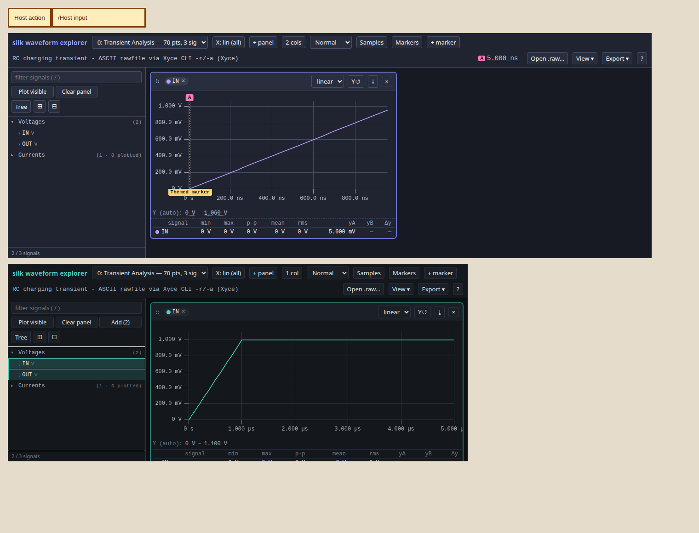

# Embed the waveform explorer

The waveform explorer is a framework-independent component. A host page mounts
it in an ordinary element; it does not need an iframe or React. The distributable
runtime is:

- `explorer.mjs` — the component and its markup (the single markup source used
  by both embedded and standalone views)
- `view.css` — all explorer styles, including uPlot 1.6.32's required CSS,
  scoped to `.silk-explorer`
- `uplot.iife.min.js` — the uPlot 1.6.32 peer dependency
- `LICENSE.uPlot` — the peer's MIT license
- `selectors.mjs` — shared hierarchy parser and Python-compatible selectors
- `waveform-core.mjs` — shared codec dependency; also supplies local nutmeg
  `.raw` reading when passed as the explorer's `waveformCore` option

The browser smoke mounts two explorers in a foreign page. The upper instance
uses a custom palette supplied through its root properties; the lower
instance uses the default palette in a resized container.



Host browsers need ES modules, CSS `@scope` and container queries, and
`ResizeObserver`. To check styling in your browser, emit a fresh page from this
checkout and open the resulting file:

```bash
.venv/bin/python -m silk.signals.view tests/fixtures/rawfiles/e_ng_tran.raw \
    -o /tmp/scope-check/view.html --inline
```

Most explorer styles live inside `@scope (.silk-explorer)`; the root container
has a separate `.silk-explorer` rule. A browser without `@scope` may show the
background and fonts but will miss the scoped controls and chart styles.
Check that the toolbar and signal list are styled; add a signal to check
the chart controls.

## Mount and lifecycle

Copy the assets with the [extraction example](#extract-assets-from-an-installed-wheel)
and serve them beside your host page. The example below assumes your application
provides `/api/waveforms/ac` and `/api/waveforms/tran` as JSON payloads from
`emit_view_data`. Use HTTPS or localhost for local rawfile hashing with Web Crypto.

Give the container explicit dimensions. The explorer fills it and a
`ResizeObserver` remeasures the plots when either dimension changes. Set theme
properties on the container before mounting so the first chart uses the right
palette.

```html
<link rel="stylesheet" href="./view.css">

<div id="waveforms" style="width:100%;height:520px;--accent:#66d9ef"></div>

<script src="./uplot.iife.min.js"></script>
<script type="module">
  import {createExplorer} from "./explorer.mjs";
  import * as waveformCore from "./waveform-core.mjs";

  const container = document.querySelector("#waveforms");
  const explorer = createExplorer(container, {
    uPlot: window.uPlot,
    waveformCore,
    stateKey: "project-17/ota/ac",
    scopes: {
      current: "ac",
      scopes: [
        {key: "ac", label: "AC", n_signals: 12},
        {key: "tran", label: "Transient", n_signals: 8},
      ],
    },
    loadScope: async (scope, {signal}) => {
      const response = await fetch(`/api/waveforms/${scope.key}`, {signal});
      if (!response.ok) throw new Error(`scope load failed: ${response.status}`);
      return response.json();
    },
  });

  const response = await fetch("/api/waveforms/ac");
  if (!response.ok) throw new Error(`waveform load failed: ${response.status}`);
  await explorer.load(await response.json());

  // On a later simulation refresh:
  // await explorer.reload(await (await fetch("/api/waveforms/ac")).json());

  // Before the host removes or reuses the container:
  // explorer.destroy();
</script>
```

The public factory accepts these options (the `?` marks an optional field;
this is an API outline, not executable JavaScript):

```text
createExplorer(container, {
  uPlot,
  waveformCore?,
  stateKey?,
  viewState?,
  commands?,
  scopes?,
  loadScope?,
  groupSignalsByKind?,
  contextMenu?,
})
```

`uPlot` is the required constructor. `waveformCore` enables **Open .raw…** and
local rawfile drops. A matching core with `build_pyramid` also enables the
`deriveSignal` command, whose operations are silk's `Signal` operation list:
`sum`, `product` and `mean` on two or more traces; `difference` and
`quotient` on exactly two; and `scale` (`gain`, `offset`), `abs`, `derivative`
and `integral` on one. The
full table with operand counts, parameters and unit rules is in
[derived signals](waveform-explorer.md#derived-signals). Without the relevant core functions, these operations
report an actionable error. Update the vendored explorer and core together;
the payload format is unchanged.

For hosts, complex AC operands may be vector/group names
or either display part name; both parts resolve to the entire complex vector.
The response remains `{name, unit, created}`. Except for `abs`, a complex
result has two signals, `{name: name + ' (mag)', part: 'mag', group: name}` and
`{name: name + ' (phase)', part: 'phase', group: name}`. Magnitude carries the
result unit; phase carries `deg`. Pass the part names to drawing commands.
`abs` instead produces one real signal with the returned name and null
`part`/`group`. Real-only derivations produce one signal. Persisted
complex definitions use the group name once, and can depend on another group
or either part.

Trace identities for derived complex parts add `part: 'mag' | 'phase'`;
identities requested by group name use `part: null`. Operand identities are
whole-vector expressions, so `silkCode` projects only the final part being
copied. A raw part's own identity still exports its magnitude/phase projection.
See the [numerical and persistence contract](waveform-explorer.md#derived-signals)
for float32 reconstruction tolerances.


`groupSignalsByKind` (default `true`) sections the signal list by the
payload's `sig.type` — Voltages, then Currents, then any other kind in its
own ordinary (unsectioned) tree, then Derived signals last; Voltages opens
and Currents starts closed. A closed section's header shows its signal
count and how many of them are plotted. Collapsing a section only hides its
rows in the list — it never affects what is plotted. Pass `false` to
show a single, unsectioned tree. This setting does not change the payload,
selectors, or plotted signals.
`emit_view`'s `group_signals_by_kind` parameter is the same setting for a
generated standalone page.
`viewState` is a validated bare view-state object applied during `load`, and
`commands` is an initial command list run after the first render.

Use an explicit, stable `stateKey` for each project/module/testbench, for
example `project-17/ota/ac`. It namespaces the saved layout in `localStorage`.
Omitting the key disables persistence. The embedded API never derives a key
from `window.location`, so two mounts do not share state unless the host gives
them the same key. Per-plot derived definitions are part of that saved view;
they rebuild against the new payload before panels are restored. Invalid or
unsupported definitions are dropped with a visible notice. See the
[view-state field contract](waveform-explorer.md#saved-derived-definitions).

Run math through `explorer.run({cmd: "deriveSignal", args: {...}})`:

| Command | Arguments | Result |
|---|---|---|
| `deriveSignal` | Required `operation: string`, `operands: string[]`; optional `params: object`, `plot: integer` (active plot by default), `name: string`, `replace: boolean` (default `false`) | `{name, unit, created}`; named identical normalized definitions return `created: false`; a new or replaced definition returns `created: true` |

`name` is a literal, non-empty/non-whitespace string; it is never trimmed.
Invalid names report `deriveSignal name must be a non-empty string`;
non-boolean `replace` reports `deriveSignal replace must be a boolean`.
The display uses the supplied name (complex: `name (mag)` / `name (phase)`,
group `name`), with the expression in a hover tooltip. No trace rename UI
exists. A conflicting name reports
`deriveSignal name "<given name>" conflicts with existing signal or trace "<existing name>" in plot <index>`.

Idempotence uses silk's canonical operand names/order and normalized parameters,
not raw argument spelling. `replace: true` may change only a definition with
that explicit `given_name` in the selected plot; it never overwrites raw or
unnamed traces or another trace's complex parts. With no earlier definition,
it creates; with no name, it leaves unnamed behavior unchanged. Replacement
atomically recomputes all descendants and updates their displayed panels,
identities and saved state. An invalid descendant fails the whole command
with its name and reason and leaves everything unchanged. See the
[panel transition and persistence contract](waveform-explorer.md#derived-signals).

A host can keep its usual rerun sequence: `await explorer.reload(payload)`,
then issue its named math commands again. Names restored from any saved-view
path behave just like names created in this session; use `replace: true` when
a block's definition changed. The optional identity and saved-definition field
`given_name` holds the base name without complex-part suffixes.
It belongs to trace identities and saved-view definitions, not waveform
payloads: importing runtime `derived.given_name` on a payload signal is
rejected. Create named math through `deriveSignal` or restore saved definitions.

The returned instance has this surface:

- `await load(payload)` initializes the explorer or replaces its dataset. It
  starts from persisted state for `stateKey`, then applies `viewState` and the
  initial `commands`. With no persisted state (a `stateKey` never seen before,
  or none supplied), waveforms start with one empty panel; operating points
  populate one panel per unit, constants use a table, and empty plots show
  a no-data notice. A
  host that wants signals plotted on first view supplies them via `viewState`
  or `commands` (`addSignal`/`addPanel`). See
  [default layout](waveform-explorer.md#default-layout).
- `await reload(payload)` refreshes an initialized dataset while retaining the
  current layout and pruning panels and signals that the replacement no longer
  contains. Calling it before `load` is equivalent to `load`.
- `await run(commandOrList)` runs one command or a sequential command list. It
  resolves to `{ok: true, results}` or a structured `{ok: false, ...}` result;
  use `commands()` to discover the supported names, arguments, and help text.
  Check `result.ok`: execution stops at the first failed command, retaining
  earlier effects; a successful single command's value is `result.results[0]`.
- `commands()` lists supported command names, arguments and help text.
- `traceIdentity(name, plot?)` returns the [identity record](#trace-identity-and-the-context-menu)
  of signal `name` in plot index `plot` (default: the plot on screen). It
  throws for an unknown signal or plot, or before `load`.
- `silkCode(identity)` renders an identity record as silk Python; see below.
- `version` is the command API version (`"1.4"` in this release).
- `destroy()` is idempotent. It destroys charts, observers, pending loads,
  timers, and handlers, restores the container's prior contents and attributes,
  and allows a later mount in the same element.

Call `destroy()` from the host component's unmount/disposal hook. Each explorer
owns its markup, state, charts, and command bus. Multiple instances can coexist
in one document without shared IDs or window globals.

The container is keyboard-focusable after mount. Pointer interaction focuses
the explorer without taking focus from its inputs and controls; shortcuts run
only while focus is on or inside that container. File drops outside the
container are left to the host page.

## Payloads and scopes

`load`, `reload`, and `loadScope` accept both current format-2 and legacy
format-1 payloads. Update the core and explorer together when moving to format 2.
There is no embedded-only payload variant. Python's emitter supplies base64
numeric leaves; `waveform-core.mjs` supplies typed-array leaves for a local
rawfile. The same `decodeF64`/`decodeY` functions accept both; decimation, stride,
and union-X behavior are unchanged. See
[Two leaf encodings (formats 1 and 2)](waveform-explorer.md#format-1-two-leaf-encodings)
for the exact leaf types.

`scopes` has shape
`{current: string|null, scopes: [{key, label, n_signals, ...}]}`. When the user
selects another scope, the explorer calls
`loadScope(scope, {signal})`. Return a payload or a promise for one and pass the
provided `AbortSignal` to any cancellable work. A newer selection or `destroy()`
aborts the old request. Reject the promise to surface an actionable load error.
Scope loads time out after eight seconds by default and abort their signal;
return an available payload rather than waiting for a simulation.
The scope control is hidden when the list contains fewer than two scopes.

## Trace identity and the context menu

A payload signal may carry an optional `address` (designer-mode emission only):
a bracketed wrapped vector name the silk reader resolves to exactly this source
row. Copy-as-code feeds it through the usual probe/part/analysis formatter; a
`label` is display text and is never read for code, and a signal without an
`address` copies its raw spelling.


Every trace in the explorer, raw or derived, has an **identity record**: a
plain, JSON-safe object built fresh on each request. The host may keep it,
serialise it or send it to a server. This outline shows both kinds of record;
raw records have the vector and probe fields, and derived records have the
operation and operands fields.

```js
{
  identity: 1,                    // record format version
  kind: "raw",                    // or "derived"
  name: "v(out) (mag)",           // the explorer's signal name
  unit: "V",
  source: {
    run_id, run_source, run_title,  // the payload's run.id / run.source / run.title
    plot: 1,                        // plot index in the payload
    plot_name: "AC Analysis",       // the simulator's plot name
    analysis: "ac",                 // silk analysis word, or null
  },
  // kind "raw":
  vector: "v(out)",               // the simulator vector the trace was drawn from
  part: "mag",                    // "mag" / "phase" for a complex vector, else null
  probe: {name: "out", type: "V", transform: "mag", analysis: "ac"},  // or null
  probe_reason: null,             // why probe is null, else null
  // kind "derived":
  given_name: "math1",            // optional: caller name, omitted for unnamed math
  operation: "difference",        // the shared operation list (see waveform-explorer.md)
  parameters: {},                 // e.g. {gain, offset} for scale
  operands: [/* identity records, recursively */],
}
```

For a checked logical source-current row, `kind` is also `raw`, but `vector`
is its logical probe name (such as `i(stim[0])`); use `probe` to read the
source current rather than treating that name as a simulator row.

`source.analysis` is `tran`, `ac`, `dc`, `noise` or `op`, using the plot name
first, then fallback properties and the axis. Unlike
`silk.signals.analysis_kind.plot_silk_analysis`, it does not strip stepped-plot
prefixes: a one-point real `Step Analysis: … DC transfer characteristic`
can be classified as `op` instead of `dc`. Check copied `analysis=` for stepped
plots. It is `null` for the simulator's constants plot.

### From a simulator vector to `tb.probe`

The explorer shows simulator vector names (`v(xdut.mid)`, `i(vvs)`,
`V(XDUT:MID)`). `tb.probe` takes the net path. `probe` holds the spelling that
makes `tb.probe` read **the same vector**:

| Vector | `probe` | silk Python |
|---|---|---|
| `v(out)`, `V(OUT)`, bare `OUT` | `{name: "out", type: "V"}` | `tb.probe('out')` |
| `v(xdut.mid)`, Xyce `V(XDUT:MID)` | `{name: "xdut.mid", type: "V"}` | `tb.probe('xdut.mid')` |
| `i(vvs)` | `{name: "vvs", type: "I"}` | `tb.probe('vvs', 'I')` |
| `vvs#branch` | `{name: "vvs#branch", type: "I"}` | `tb.probe('vvs#branch', 'I')` |
| complex `v(out)` part `mag` | `transform: "mag"` | `tb.probe('out').mag()` |
| complex `v(out)` part `phase` | `transform: "phase_deg_unwrapped"` | `tb.probe('out').phase_deg_unwrapped()` |

A branch current may be written `tb.probe('vvs', 'I')` (raw vector) or
`tb.probe('i(vs)')` (source name; also valid as a metric's signal path). `i(x)`
reads source `x` if the bench has one, else the raw vector `x`. When `x` is
both a source name and another source's emitted instance (sources `vs` and
`vvs`), `i(vvs)` raises `AmbiguousBranchCurrentError` rather than guess which
branch you meant. Names are lower-cased, which
does not change what they match, because SPICE names are case-insensitive.
When the payload holds more than one plot, `probe.analysis` names the plot.
`tb.probe` cannot read a multi-plot rawfile without it.

When no spelling is safe, `probe` is `null` and `probe_reason` gives the
reason. The explorer does not guess. These cases have no probe:

- noise spectra (`onoise_spectrum` and the like), which `tb.probe` refuses
  as unknown nets
- device-parameter vectors (`@m…[gm]`)
- simulator-internal nodes (`…#dbody`)
- differential `v(a,b)`
- a vector name that occurs twice in one plot
- the constants plot

### Copy as silk code

`silkCode(identity)` returns `{ok: true, code}` or `{ok: false, reason}`. A
raw trace becomes a `tb.probe(...)` call. A derived trace becomes the
matching expression on its operands' code, with the parentheses Python
needs:

| operation | code |
|---|---|
| sum | `a + b + …` |
| difference | `a - b` |
| product | `a * b * …` |
| quotient | `a / b` |
| mean | `(a + b + …) / n` |
| scale | `gain * a + offset`; `gain` 1 and `offset` 0 are left out |
| abs | `a.mag()` |
| derivative | `a.derivative()` |
| integral | `a.integral()` |

For example, a difference of `v(xdut.vout)` and `v(vref)` copies as
`tb.probe('xdut.vout') - tb.probe('vref')`. If any operand has no probe,
the whole derived trace reports that operand's reason. The code assumes a
testbench named `tb`, the one whose run the payload shows.

The trace items appear in the derive menu, below the derive entries. Right-click
an unselected signal row to select it exactly as a plain left-click would,
replacing any previous selection, and open the viewer's menu. Right-clicking
an already-selected row preserves the whole selection. The ContextMenu key and
Shift+F10 apply the same rule to the focused row. One selected trace shows the
single-trace operations; several show the multi-trace ones. In both cases,
**Copy as silk code** comes after the derive entries, followed by host items
for the clicked trace. Empty list space and headers keep the browser's native
menu. Pure group rows retain their existing selection-menu behavior.

The built-in item **Copy as silk code** (`copy-silk-code`) copies the code
to the clipboard. For a trace with no equivalent, it shows the reason and
copies nothing.

### Host menu items

```js
createExplorer(container, {
  uPlot,
  contextMenu: {
    items: [
      {id: "keep", label: "Keep in test", onSelect: identity => keepInTest(identity)},
    ],
    hide: ["copy-silk-code"],     // e.g. a GUI for users who do not write Python
  },
});
```

- `items` are added after the built-in items, in order. Each has a
  nonempty `label`, an `onSelect(identity)` callback that receives the
  trace's identity record, and an optional unique `id` (default
  `host-<index>`). An exception thrown by the callback is shown in a toast.
- `hide` lists built-in item ids to remove. The built-in ids are exported
  as `TRACE_MENU_ITEMS` (currently only `copy-silk-code`).
- The host chooses its own items' labels and, through the theme contract,
  how the menu looks. Built-in items keep silk's labels and behaviour. A
  host item cannot reuse a built-in id, and no option renames a built-in.
- `createExplorer` validates the option before it touches the container. It
  throws a `TypeError` for an unknown key, an unknown `hide` id, a bad item,
  or a duplicate or built-in id.
- With the built-in item hidden and no host items, the derive menu shows
  only its derive entries.

`explorer.mjs` also exports the DOM-free pieces: `traceIdentityOf(payload,
plot, name)`, `silkCode`, `probeFor(vector, part)` and `plotAnalysis(plot)`.
A host can use them to build identities on its server side from the same
payload.

## Theme contract

Set any of these properties on the mount container before calling
`createExplorer`. Defaults preserve the standalone explorer's palette.

| Property | Default | Use |
|---|---|---|
| `--bg-0` | `#0d1013` | Explorer and fatal backgrounds |
| `--bg-1` | `#14181d` | Charts, toolbar, panels, PNG background |
| `--bg-2` | `#1b2027` | Controls, menus, secondary surfaces |
| `--bg-3` | `#232933` | Hover and raised surfaces |
| `--border` | `#2b323d` | Panel, control, and chart grid borders |
| `--border-soft` | `#232933` | Subtle separators |
| `--text-0` | `#dfe4ea` | Primary text and PNG title text |
| `--text-1` | `#a7b0bd` | Secondary text and chart labels |
| `--text-2` | `#6d7686` | Muted text, ticks, and hints |
| `--accent` | `#4fd1c5` | Focus, active controls, and highlights |
| `--accent-dim` | `#2e7a72` | Dim accent borders |
| `--amber` | `#e0a640` | Amber status accents |
| `--cursor-a` | `#5b9bd5` | Cursor A line, badge, and export tag |
| `--cursor-b` | `#e08a3c` | Cursor B line, badge, and export tag |
| `--sev-info` | `#5b9bd5` | Informational annotations |
| `--sev-warn` | `#e0a640` | Warning annotations and badges |
| `--sev-error` | `#e0575a` | Error annotations and invalid states |
| `--trace-1` | `#4fd1c5` | Trace palette 1 |
| `--trace-2` | `#e0a640` | Trace palette 2 |
| `--trace-3` | `#5b9bd5` | Trace palette 3 |
| `--trace-4` | `#e08a3c` | Trace palette 4 |
| `--trace-5` | `#9b7fe0` | Trace palette 5 |
| `--trace-6` | `#7fc97f` | Trace palette 6 |
| `--trace-7` | `#e0575a` | Trace palette 7 |
| `--trace-8` | `#c9c15a` | Trace palette 8 |
| `--trace-9` | `#5ad1a0` | Trace palette 9 |
| `--trace-10` | `#c98fd6` | Trace palette 10 |
| `--marker-1` | `#e0575a` | Marker palette 1 |
| `--marker-2` | `#5ad1a0` | Marker palette 2 |
| `--marker-3` | `#c98fd6` | Marker palette 3 |
| `--marker-4` | `#e0a640` | Marker palette 4 |
| `--marker-5` | `#9b7fe0` | Marker palette 5 |
| `--marker-6` | `#7fc97f` | Marker palette 6 |
| `--marker-7` | `#4fd1c5` | Marker palette 7 |
| `--marker-8` | `#c9c15a` | Marker palette 8 |
| `--annotation-band` | `rgba(79, 209, 197, 0.10)` | Annotation range fill |
| `--annotation-marker` | `#e0a640` | Default annotation marker |
| `--tag-text` | `#08151a` | Text over cursor and marker colors |
| `--selection-fill` | `rgba(79, 209, 197, 0.22)` | Plot selection and zoom fill |
| `--selection-row` | `rgba(79, 209, 197, 0.14)` | Selected picker row |
| `--selection-row-hover` | `rgba(79, 209, 197, 0.20)` | Selected picker row hover |
| `--invalid-fill` | `rgba(224, 87, 90, 0.28)` | Invalid-value fill |
| `--drop-overlay` | `rgba(15, 20, 26, 0.85)` | File-drop overlay |
| `--overlay-backdrop` | `rgba(0, 0, 0, 0.5)` | Modal backdrop |
| `--shadow-color` | `rgba(0, 0, 0, 0.5)` | Strong shadows |
| `--shadow-soft` | `rgba(0, 0, 0, 0.4)` | Toast and soft shadows |
| `--uplot-cursor` | `#607d8b` | uPlot pointer crosshair |

The non-color variables are `--mono` and `--ui` for font stacks,
`--fs-base` (default `14px`), `--row-h` (default
`calc(var(--fs-base) + 10px)`), and `--panel-chart-h` (default `260px`). The
explorer's font-size control updates `--fs-base` on the container.

## Standalone compatibility

Emitted `view.html` pages use the same `explorer.mjs` renderer. The small
`view.js` compatibility shim mounts one instance on `document.body` and alone
owns the standalone page globals. It provides `window.silkView` command
execution/discovery/version, initial `SILK_VIEW_DATA`, view state, commands,
configuration and scopes, and the `__silkViewData` / `__silkViewStamp`
callbacks used by data-sidecar polling and scope changes. It also retains
query-string commands and local **Open .raw…** behavior. Embedded hosts should
use the instance API above and do not receive these globals.

## Extract assets from an installed wheel

The assets are package data and can be copied through `importlib.resources`
without transforming their bytes. This works for a source checkout or an
installed wheel:

```python
from importlib.resources import files
from pathlib import Path

names = (
    "explorer.mjs", "selectors.mjs", "view.css", "uplot.iife.min.js",
    "LICENSE.uPlot", "waveform-core.mjs",
)
source = files("silk.signals.view") / "assets"
destination = Path("static/silk-explorer")
destination.mkdir(parents=True, exist_ok=True)
for name in names:
    (destination / name).write_bytes((source / name).read_bytes())
```

The copied files are byte-identical to the packaged assets. Keep
`LICENSE.uPlot` with redistributed uPlot. `uplot.min.css` also remains shipped
unchanged for consumers that use uPlot separately; the explorer already
contains its scoped rules in `view.css`.

## Checked designer node metadata

Python hosts can opt in after a successful silk run. Here `tb` is the
testbench that produced the results:

```python
from silk.circuit import view_node_context
from silk.signals.view import emit_view_data

nodes = view_node_context(tb)  # also accepts a directly simulated Module
source = nodes.source if nodes is not None else tb.results_file
payload = emit_view_data(source, node_context=nodes, labels='designer')
```

`emit_view` accepts the same `node_context=` keyword. `ViewNodeContext`, exported
from `silk.signals.view`, is an opaque checked snapshot, not a graph dictionary.
Its `source` is borrowed read-only: do not modify plots, vectors or samples.
Obtain a fresh context for each emission. The helper uses the bench's existing
result route, including selected-test scope; missing or unsupported result
associations return `None`. Unavailable retained run files raise
`SimulationError`; restore the original outputs or rerun. It checks the successful run's immutable address
facts and the fingerprint of the disk bytes actually parsed. The emitter also
compares the current vector inventory with the frozen proof. Replaced files or
mutated inventories cannot reuse that proof. `context=` remains display-only
run information. Calls without `node_context` emit waveform data without
checked graph metadata.

Both payload formats accept optional per-plot `node_paths`:

```json
{"version": 1,
 "vectors": [{"name": "time", "selectable": false},
             {"name": "v(xdut.mid)", "selectable": true}],
 "paths": [{"name": "dut.Mid", "targets": [{"id": 0, "rows": [1]}]}]}
```

The vector inventory includes excluded rows. Candidate targets include unsaved
nodes (`rows: []`); distinct target IDs must never be collapsed. IDs are local
to this snapshot and reused across its plots, not trace identities. Selected
physical signals carry `source_row` (original row index); complex parts share
it. A `node_probe: {"name": "v(dut.Mid)", "type": "V"}` is a checked exact voltage
argument. Independent-source current cards use the same field with type `I`,
for example `node_probe: {"name": "i(Vstim[0]__silk_dc)", "type": "I"}`.
These checked card probes keep the required branch prefixes and use `[k]`
for array indices. A logical source row instead carries its signed physical
row references inside the same checked probe, for example
`node_probe: {"name": "i(stim[0])", "type": "I", "terms": [{"row": 7, "sign": 1}]}`,
and has no `source_row`; a parallel current source has two terms. Its samples
are composed before complex expansion and decimation, and its vector name is
the logical probe name rather than a simulator vector. Forward `name` and
`type` when constructing a probe. Every contributing current card must be
saved; default selection omits incomplete logical currents, while explicitly
requesting one raises `ViewError` naming the cards to save before rerunning.
`node_probe: null` refuses copy; an absent field retains legacy copy.
`address` still means the emitted/bracket spelling. Never derive a probe from
`label`, lowercase a checked argument, or rewrite its punctuation. The browser
validates metadata and consumes it; only Python produces graph metadata.

Ship `selectors.mjs` beside `explorer.mjs` and `waveform-core.mjs`. It exports
`hierParse({name, part=null})`, `matchesSelector(name, selector)` and
`selectNodePaths(plots, {signals=null, exclude=null, max_depth=null})`. Each input
plot supplies `vectors: [{name, selectable}]` and optional `node_paths`; the
result is `{masks, diagnostics}`, with masks in original row order. With no
metadata it selects raw names. Dot and colon separate hierarchy outside square
brackets on both simulators, without a dialect argument. The selector forms
match Python: exact names, glob patterns and bare hierarchy fragments.

Emitted matches across the full inventory take precedence over designer
matches; conflicting matches produce an `emitted-precedence` diagnostic naming
`selector` and `keyword`. Exact ambiguous designer paths raise
`AmbiguousSelectorError`; globs and hierarchy fragments select sets. An unknown
selector raises `SelectorNotFoundError` and an empty final selection raises
`EmptySelectionError`. The first two carry `.selector` and `.kwarg`.
Malformed metadata raises `ViewError`. The three selection errors subclass
`SelectionError`, which is a `ViewError` and a `ValueError`, and the browser
raises the same class names. Browser masks do not recover omitted samples. **`exclude=` does not redact names** from metadata.

The serialized metadata estimate, including keys, escaping and per-signal
additions, is capped at 8 MiB per payload. Metadata also counts against
`emit_view(max_bytes=...)`. Exceeding either budget omits the entire graph
enhancement with a warning and legacy labels, retaining the already-selected
physical waveform rows. A waveform-only payload over `max_bytes` still raises.
`emit_view_data` retains no total-size argument but applies the metadata cap.
A selection containing logical source currents instead raises `ViewError` if
that fallback would discard any of them. The error names the affected currents
and metadata cap/remaining payload budget. Reduce exported metadata, or increase
`max_bytes` when payload-limited; physical-only selections retain the warning
and fallback above.
Checked facts are immutable and shared by selection; the byte counter stops
incrementally at the budget before constructing serialized graph output. The
warning states the cap and remaining payload budget and identifies the loss of
browser graph selection and checked copy.

Metadata participates in Python's `run.id`; raw signal/group/state keys remain
unchanged, and label-only refresh restores state. Opening a local rawfile drops
prior graph metadata and uses the existing browser producer and hash contract.
